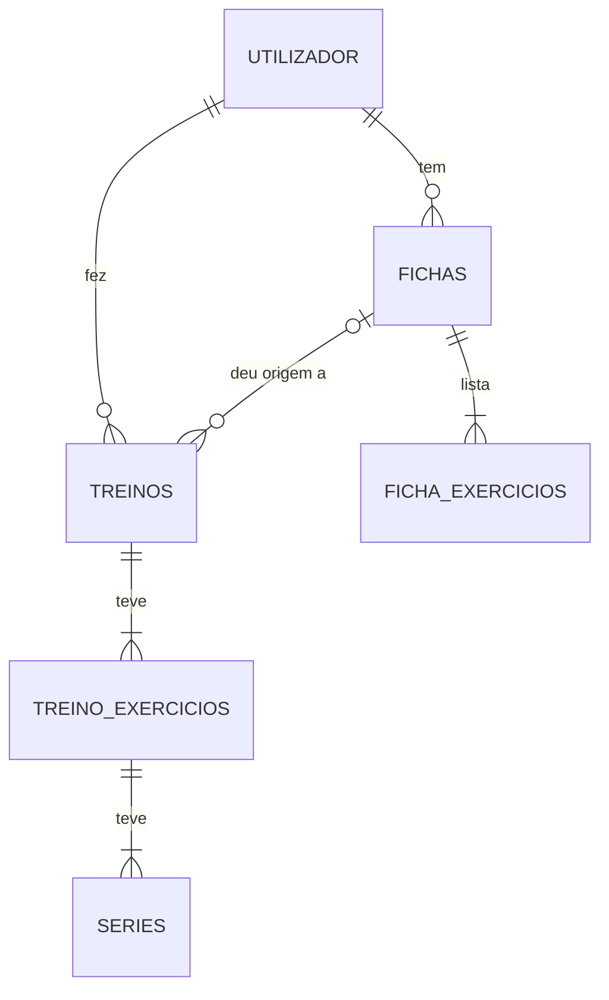

# Planeamento — Diário de Treinos (Fase 2)

A fase 2 junta ao RepLog uma **base de dados** e **login**, com o [Supabase](https://supabase.com): as fichas e os treinos passam do `localStorage` do navegador para a conta de cada utilizador e aparecem em qualquer aparelho. As duas fases são entregues juntas, na mesma data.

O planeamento da fase 1 (interface, componentes, API de exercícios) continua em [`planeamento.md`](planeamento.md).

## 1. Decisões

| Tema | Decisão | Porquê |
|---|---|---|
| Back-end | **Supabase**: base de dados Postgres, autenticação e API prontas | Indicação do professor. O "código do back-end" é o SQL (tabelas, regras de segurança, funções), guardado no repositório em `supabase/migrations/` e aplicado com a **Supabase CLI** |
| Login | **Email e palavra-passe**, com o Supabase Auth: registar, entrar, sair, recuperar a palavra-passe | É o mais comum e não depende de serviços de terceiros (Google…) que podem falhar na demonstração |
| Tabelas | **Relacionadas**: `fichas` → `ficha_exercicios`; `treinos` → `treino_exercicios` → `series` | Mostra modelação de base de dados a sério: chaves estrangeiras, regras e apagar em cascata |
| Sem conta | **Login obrigatório**: sem sessão só se veem as páginas de entrar e registar | Os dados são sempre da conta; não há dois sítios para juntar |
| Treino em curso | Fica **no aparelho** (`localStorage`) até se terminar; só então vai para a base de dados | No ginásio a rede é má: registar uma série não pode depender da internet |
| Ligação ao Supabase | Cliente oficial `@supabase/supabase-js`; os services devolvem `Observable` (com `from()`), como o resto da app | O cliente trata da sessão (guardar, renovar o token). A ExerciseDB continua com `HttpClient` |
| Dados que já estão no aparelho | Ao entrar pela primeira vez, a app oferece-se para os **importar** para a conta | Quem já usou a fase 1 não perde as fichas nem o histórico |

## 2. Modelo de dados



O utilizador é a tabela `auth.users` do Supabase Auth (email, palavra-passe cifrada); a app não lhe mexe diretamente.

**`fichas`**

| Coluna | Tipo | Regras |
|---|---|---|
| `id` | `uuid` | chave primária, gerada pela base de dados |
| `user_id` | `uuid` | dono da ficha → `auth.users`; por omissão `auth.uid()`; apagar o utilizador apaga as fichas |
| `nome` | `text` | 3 a 40 caracteres, não pode ser só espaços |
| `tipo` | `text` | `push`, `pull`, `legs`, `upper`, `lower` ou `full` |
| `criada_em` | `timestamptz` | por omissão, agora |

**`ficha_exercicios`** — os exercícios de cada ficha, por ordem

| Coluna | Tipo | Regras |
|---|---|---|
| `id` | `uuid` | chave primária |
| `ficha_id` | `uuid` | → `fichas`; apagar a ficha apaga os exercícios (cascata) |
| `ordem` | `smallint` | posição na ficha; única dentro da ficha |
| `exercicio_id` | `text` | id do exercício na ExerciseDB (ex.: `EIeI8Vf`) |
| `nome` | `text` | nome em inglês, como vem da API (a tradução é feita no ecrã) |
| `grupo` | `text` | `peito`, `costas`, `pernas`, `ombros`, `bracos`, `abdominais`, `gemeos` ou `cardio` |
| `series` | `smallint` | 1 a 10 |
| `repeticoes` | `smallint` | 1 a 50 |

**`treinos`** — os treinos terminados (o histórico)

| Coluna | Tipo | Regras |
|---|---|---|
| `id` | `uuid` | chave primária |
| `user_id` | `uuid` | → `auth.users`, como nas fichas |
| `ficha_id` | `uuid` ou nada | → `fichas`; **nada** num treino livre; se a ficha for apagada, fica nada e o treino continua no histórico |
| `nome_ficha` | `text` | cópia do nome da ficha (ou "Treino livre"), para o histórico não depender da ficha |
| `inicio`, `fim` | `timestamptz` | `fim` não pode ser antes do `inicio` |

**`treino_exercicios`** — `id`, `treino_id` (→ `treinos`, cascata), `ordem`, `exercicio_id`, `nome`, `grupo`, `notas` (opcional).

**`series`** — `id`, `treino_exercicio_id` (→ `treino_exercicios`, cascata), `numero`, `carga` (`numeric`, 0 a 999 kg), `repeticoes` (0 a 100), `feita` (`boolean`).

Os nomes das colunas ficam em `snake_case` (o costume no Postgres); o service converte para os nomes das interfaces TypeScript (`exercicioId`, `nomeFicha`…), que não mudam.

## 3. Segurança

- **RLS (Row Level Security)** ligado em todas as tabelas: cada utilizador só lê e altera as suas linhas. `fichas` e `treinos`: `user_id = auth.uid()`. As tabelas "filhas" verificam o dono através da tabela "mãe" (ex.: uma linha de `ficha_exercicios` só é visível se a ficha for do utilizador).
- A regra está **na base de dados**: mesmo que alguém use a chave pública fora da app, não vê os dados dos outros.
- **Chaves:** a chave **pública** (*anon / publishable*) e o URL do projeto ficam no código (`src/environments/environment.ts`): foram feitas para isso. A chave **`service_role` / secret** e a **palavra-passe da base de dados** nunca entram no código, no repositório nem em mensagens.
- As palavras-passe dos utilizadores são tratadas pelo Supabase Auth (cifradas); a app nunca as guarda.

## 4. Gravar dados: funções SQL

Uma ficha são várias linhas (a ficha e os seus exercícios); um treino ainda mais (exercícios e séries). Para não ficar nada gravado pela metade, cada um é gravado por uma **função SQL** (chamada da app com `rpc()`), que corre tudo numa só transação: ou fica tudo, ou nada.

| Função | Faz |
|---|---|
| `guardar_ficha(...)` | Cria ou edita uma ficha e substitui a lista de exercícios |
| `guardar_treino(...)` | Grava um treino terminado, com os exercícios e as séries. O id vem da app (`crypto.randomUUID()`, desde que o treino começa); se esse id já existir, não grava outra vez |

As funções correm com as permissões de quem as chama (*security invoker*), por isso as regras de RLS também se aplicam lá dentro. Ler e apagar faz-se diretamente pelo cliente: ler uma ficha com os exercícios é um só pedido (`select('*, ficha_exercicios(*)')`), e apagar uma ficha apaga os exercícios em cascata.

**Porquê o id do treino vem da app:** um treino terminado sem rede fica no aparelho e é enviado mais tarde. Se o envio for repetido (o treino ficou gravado, mas a resposta perdeu-se pelo caminho), a função vê que o id já existe (`on conflict do nothing`) e o treino não fica duplicado no histórico.

## 5. Autenticação

**Páginas novas** (formulários reativos):

| Rota | Página | Validação |
|---|---|---|
| `entrar` | Entrar (email + palavra-passe) | `required`, `Validators.email` |
| `registar` | Criar conta | `Validators.email`, palavra-passe com 8+ caracteres, "repetir palavra-passe" igual (validador do grupo, nosso) |
| `recuperar-palavra-passe` | Pedir o email para mudar a palavra-passe | `Validators.email` |
| `nova-palavra-passe` | Escolher a nova: a partir do link do email, ou com sessão, em "Mudar a palavra-passe" no menu | as mesmas regras do registo |

**Guards** (pasta `guards/`):
- `sessaoGuard` (`CanActivateChildFn`) numa rota-mãe sem componente que agrupa todas as páginas da app: sem sessão → vai para `entrar?voltar=/a/pagina/pedida`, e depois de entrar volta lá.
- `visitanteGuard` (`CanActivateFn`) em `entrar` e `registar`: com sessão → vai para o Início.

**`AuthService`:** o utilizador atual num `signal` (o ecrã atualiza-se sozinho ao entrar e ao sair); `registar`, `entrar`, `sair`, `pedirRecuperacao`, `mudarPalavraPasse`. A sessão é lida no arranque (`provideAppInitializer`), antes de os guards decidirem. Os erros do Supabase são mostrados em português ("Email ou palavra-passe errados", "Este email já tem conta", "Confirma o email antes de entrar"…).

**Layout:** sem sessão, sem menu nem cabeçalho: só um cartão ao centro, o componente `CartaoAuth` (logótipo e título), onde cada página põe o seu formulário com `<ng-content>`. Com sessão, o layout de sempre; no fundo do menu ficam o email do utilizador, "Mudar a palavra-passe" e **Sair** (termina a sessão neste aparelho, mesmo sem rede). Sai do menu o item "Progresso", que estava lá à espera da fase 2.

**No painel do Supabase** (configuração feita pelo dono do projeto): *Site URL* = `https://fredbusich.github.io/projeto-angular/`; *Redirect URLs* = `https://fredbusich.github.io/projeto-angular/**` e `http://localhost:4200/**`; confirmação de email ligada; emails em português (opcional).

## 6. O que muda na app

| Peça | Fase 1 | Fase 2 |
|---|---|---|
| `SupabaseService` (novo) | — | Cria o cliente do Supabase uma vez, para a app toda. `pedido()` passa uma consulta a `Observable`, com os erros em português (`utils/erros-bd.ts`) |
| `AuthService` (novo) | — | Sessão e utilizador; registar, entrar, sair, recuperar. `idUtilizador` (um `computed`) só muda quando muda a pessoa |
| `FichaService` | `localStorage` | Tabelas `fichas` + `ficha_exercicios`; carrega ao entrar e esvazia ao sair (um `effect` segue o `idUtilizador`). Criar, editar e apagar devolvem `Observable`: a página espera pela resposta e mostra o erro, se houver |
| `TreinoService` | `localStorage` | Histórico nas tabelas `treinos`, `treino_exercicios` e `series`; o treino em curso e os treinos por enviar ficam no aparelho, numa chave por utilizador |
| `ImportacaoService` (novo) | — | Passa as fichas e os treinos da fase 1 (que estavam no aparelho) para a conta |
| `ArmazenamentoService` | Tudo | Só o que é do aparelho: tema, língua, treino em curso, treinos por enviar |
| Páginas Fichas, Treino, Histórico, Início, Exercícios, formulário da ficha | Dados imediatos | Estados **a carregar** e **erro**, com "Tentar outra vez", como na lista de exercícios; botões "A guardar…" / "A apagar…" enquanto a base de dados não responde |
| Ids | Gerados na app (`gerarId`) | Fichas: gerados pela base de dados (`uuid`). Treinos: `crypto.randomUUID()` na app (ver a secção 4) |

**Treinos por enviar:** "Terminar e guardar" põe o treino numa lista no aparelho e envia-o logo a seguir. Sem rede, fica lá (com a etiqueta "Por enviar" no histórico) e é enviado quando a rede voltar (evento `online` do navegador), ao abrir a app, ou no botão "Enviar agora" do Histórico. Um treino que falhe não impede os outros de seguir.

**Treinar sem rede:** o treino em curso está no aparelho, por isso abre mesmo sem rede. Para começar um treino novo é preciso o histórico (dá as cargas da última vez) e a ficha.

**Importar:** se o aparelho ainda tiver fichas ou treinos da fase 1, aparece um aviso no Início: "Encontrámos 3 fichas e 5 treinos guardados neste aparelho… Queres importá-los para a tua conta?". As fichas são criadas uma a uma e cada uma sai do aparelho logo a seguir (se a rede falhar a meio, ao tentar outra vez continua onde parou); os treinos vão para a lista "por enviar", com um id novo e o id da ficha nova.

## 7. Requisitos que a fase 2 reforça

- **Formulários reativos:** o `Validators.email` passa a ter onde ser usado, e há um validador de grupo nosso (palavras-passe iguais).
- **Router:** guards (`CanActivateFn`) e redirecionar para a página pedida depois de entrar.
- **Services e DI:** `SupabaseService` injetado no `AuthService`, no `FichaService` e no `TreinoService`.
- **Dados externos:** duas fontes, a ExerciseDB (`HttpClient`) e o Supabase (cliente oficial), ambas atrás de services e com estados de carregamento e erro.

## 8. Supabase CLI e migrações

O SQL é aplicado ao projeto com a **Supabase CLI** (instalada no PC, comando `supabase`), e não colado à mão no painel: assim, o que está no repositório é exatamente o que está na base de dados.

| Comando | Para quê |
|---|---|
| `supabase init` | Criou a pasta `supabase/` (com o `config.toml`) |
| `supabase migration new <nome>` | Cria um ficheiro `supabase/migrations/<data e hora>_<nome>.sql`; a data no nome dá a ordem |
| `supabase login` | Liga a CLI à conta Supabase (abre o navegador para autorizar) |
| `supabase link --project-ref <ref>` | Liga a pasta ao projeto na nuvem (pede a palavra-passe da base de dados, escrita pelo dono) |
| `supabase db push` | Aplica à base de dados as migrações que ainda lá não estão |
| `supabase migration list` | Mostra que migrações já foram aplicadas |
| `supabase db lint` | Verifica as funções contra as tabelas reais (tipos, colunas) |
| `npm run tipos:bd` (na pasta `frontend`) | Gera `modelos/base-de-dados.ts`: os tipos TypeScript das tabelas e funções, lidos da base de dados (`supabase gen types`). Correr de novo depois de cada migração |

As migrações, por ordem: `…_tabelas.sql` (tabelas, regras e índices), `…_seguranca.sql` (RLS e permissões), `…_funcoes.sql` (`guardar_ficha`, `guardar_treino`) e `…_treino_com_id.sql` (passo 14: `guardar_treino` passa a aceitar o id do treino). Uma migração já aplicada não se altera: uma mudança é sempre uma migração nova, como esta quarta.

A CLI também consegue correr uma cópia do Supabase no PC (`supabase start`), mas isso precisa do Docker; aqui trabalha-se diretamente com o projeto na nuvem.

**Tamanho da app:** o cliente do Supabase faz a app inicial passar de 452 kB para 682 kB (165 kB comprimidos, o que viaja pela rede). Com as páginas de autenticação fica em 704 kB, e com os dados no Supabase em 722 kB. O aviso do `angular.json` subiu de 500 kB para 750 kB; o limite de erro continua em 1 MB.

## 9. Estrutura de pastas (novidades)

```
projeto-angular/
├── supabase/
│   ├── config.toml           configuração do projeto para a CLI
│   └── migrations/           o SQL, por ordem: tabelas, segurança (RLS), funções, treino com id
└── frontend/src/
    ├── environments/         environment.ts: URL e chave pública do Supabase
    └── app/
        ├── componentes/      + cartao-auth
        ├── guards/           sessao-guard, visitante-guard
        ├── paginas/          + entrar, registar, recuperar-palavra-passe, nova-palavra-passe
        ├── servicos/         + supabase-service, auth-service, importacao-service
        └── utils/            + erros-auth, erros-bd (as mensagens de erro em português); sai o gerar-id
```

## 10. Plano de trabalho (um ramo e um PR por passo)

| # | Ramo | O que se faz |
|---|---|---|
| 11 | `planeamento-fase2` | Este documento |
| 12 | `supabase` | SQL das tabelas, RLS e funções (aplicado com a Supabase CLI); `@supabase/supabase-js`, `environment.ts`, `SupabaseService`, `AuthService` |
| 13 | `autenticacao` | Páginas de entrar, registar e recuperar a palavra-passe; guards; layout sem sessão; "Sair" no menu; configuração da autenticação no painel |
| 14 | `dados-supabase` | `FichaService` e `TreinoService` na base de dados; estados a carregar/erro; treinos por enviar; importar os dados do aparelho |
| 15 | `fase2-acabamento` | Sem rede com o Supabase (service worker), README, planeamento, publicação |

## 11. Riscos e cuidados

- **Plano gratuito do Supabase:** o projeto é posto em pausa ao fim de 7 dias sem uso. Antes da apresentação, abrir o painel ou usar a app uns dias antes (reativar demora uns minutos).
- **Emails de confirmação:** o serviço de email incluído no Supabase envia poucos emails por hora. Criar as contas de teste e de demonstração com antecedência; se for preciso, desligar a confirmação durante o desenvolvimento (decisão no passo 13).
- **Testes com sessão:** o login passa pelos servidores do Supabase, por isso o Claude não cria contas nem entra por ti; és tu que entras no navegador de pré-visualização e os testes continuam a partir daí.
- **Dados da fase 1:** a importação só corre quando o utilizador aceita, e os dados só saem do aparelho depois de gravados na conta.
